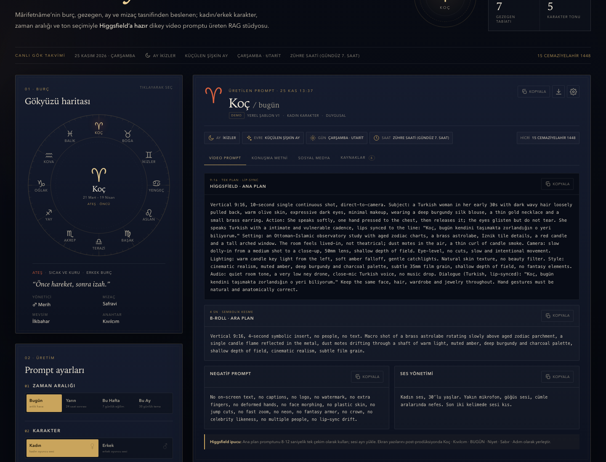
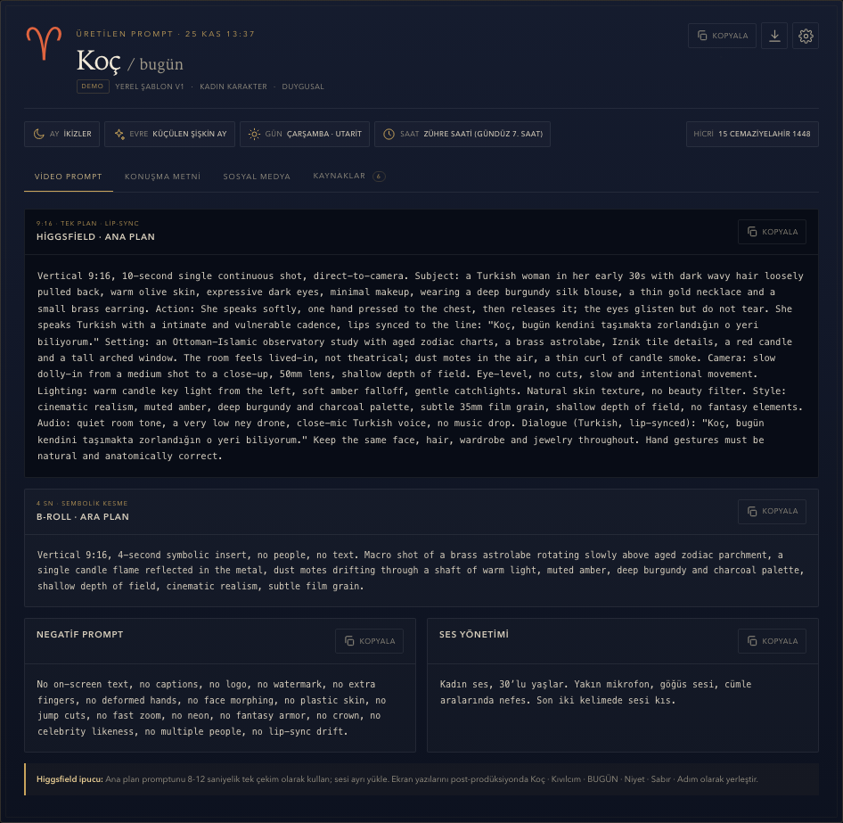

# Mârifetnâme Prompt Atölyesi

[](https://ahmetosmantatli.github.io/marifetname-prompt-studio/) [](https://github.com/ahmetosmantatli/marifetname-prompt-studio)

**Canlı:** <https://ahmetosmantatli.github.io/marifetname-prompt-studio/>

Erzurumlu İbrahim Hakkı'nın **Mârifetnâme**'sindeki burç, gezegen, Ay, mizaç ve mevsim tasnifinden beslenen; kadın/erkek karakter, zaman aralığı ve ton seçimiyle **Higgsfield'a hazır dikey video promptu** üreten RAG stüdyosu.

> Kehanet değil, tefekkür. Yıldızlar sebep; hakiki müessir Allah.





## Ne yapar?

- **12 burç profili**: unsur, modalite, yönetici gezegen, mizaç, gölge, arzu, yara, ses ve jest dili.
- **4 zaman aralığı**: bugün, yarın, bu hafta, bu ay. Ay burcu, Ay evresi, gezegen günü/saati, mevsim ve hicri tarih otomatik hesaplanır.
- **5 ton**: duygusal, agresif, sakin, gizemli, otoriter. Karakter kadın veya erkek seçilebilir.
- **RAG**: Mârifetnâme'den derlenmiş 49 bilgi kartı üzerinden BM25 + isteğe bağlı Gemini embedding ile hibrit arama.
- **Higgsfield çıktısı**: İngilizce ana plan promptu, B-roll promptu, negatif prompt, ses yönetimi, ekran yazıları ve sosyal medya metni.
- **Atıf modu**: yok / ara sıra / güçlü. Güçlü modda sayfa numaralı Mârifetnâme atfı yapılır.
- **Demo modu**: API anahtarı olmadan çalışır; canlı siteyi ve akışı hemen test etmek için.
- **Groq ve Gemini**: ücretsiz katman modelleriyle çalışır. Anahtarlar yalnızca tarayıcıda saklanır; bu projenin arka ucu yoktur.

## Hızlı başlangıç

```bash
npm install
npm run dev
```

Açılan adreste sağ üstteki **Ayarlar**'dan:

1. **Demo** ile anahtarsız deneyin.
2. **Groq** seçip `gsk_...` anahtarını girin; model olarak `llama-3.3-70b-versatile` önerilir.
3. **Gemini** seçip `AIza...` anahtarını girin; model olarak `gemini-2.5-flash` önerilir.
4. İsterseniz **Semantik RAG**'i açın; Gemini embedding ile anlamsal arama devreye girer.

Anahtarlar nereden alınır?

- Groq: <https://console.groq.com/keys>
- Gemini: <https://aistudio.google.com/app/apikey>

## Nasıl çalışır?

### 1. Bilgi tabanı

`src/data/knowledge.ts` içindeki 49 kart; Mârifetnâme'nin şu bölümlerinden özetlenmiştir:

- Burçlar feleği ve on iki burç (s. 67-69)
- Unsurlar, modaliteler, erkek/dişi burçlar (s. 69)
- On iki burç, on iki ay, dört mevsim (s. 77)
- Yedi gezegenin tabiatı (s. 88-120)
- Ay'ın burçlara göre iş takvimi (s. 122-127)
- Gezegen günleri ve saatleri (s. 128-129)
- Mevsimlerin mizacı (s. 144)
- Beldelerin burç/gezegen nispeti (s. 185-186)
- Dört unsur, dört karışım ve mizaç (s. 224-226)
- Mevsimlere göre beden/ruh (s. 231-233)
- Aşkın bedende teşhisi (s. 234)

Ayrıntılı kaynak haritası: [`docs/KNOWLEDGE_BASE.md`](docs/KNOWLEDGE_BASE.md).

### 2. RAG

`src/lib/rag.ts` içinde:

- Türkçe karakter normalizasyonu ve stopword temizliği
- BM25 (k1=1.5, b=0.75)
- Burç, gezegen, unsur ve Ay burcu etiketlerine göre ağırlıklandırma
- İsteğe bağlı Gemini embedding ile hibrit skor (`%62 BM25 + %38 anlamsal`)
- Embedding indeksi IndexedDB'de önbelleklenir; her ziyarette yeniden üretilmez.

### 3. Gök takvimi

`src/lib/astro.ts` içinde:

- Güneş ve Ay boylamı (düşük hassasiyetli Meeus formülleri)
- Burç, Ay evresi ve aydınlanma oranı
- İstanbul için gün doğumu/batımı ve zamanî gezegen saati
- Hicri tarih (`islamic-umalqura`)
- Hafta/ay görünümünde Ay'ın dönem içinde geçtiği burçlar

Ay burcu yaklaşık ±1-2° hassasiyetledir; burç sınırına çok yakın günlerde farklılık gösterebilir. Bu bir astronomi uygulaması değil, içerik atmosferi aracıdır.

### 4. Prompt motoru

`src/lib/prompt.ts` iki katmanlı çalışır:

- **Sistem promptu**: karakter sesi, zaman/tone uyumu, İslami çerçeve, atıf kuralları, kehanet yasağı, Higgsfield prompt yapısı.
- **Kullanıcı promptu**: burç dosyası + gök takvimi + RAG pasajları + üretim girdileri.

Çıktı şeması:

```json
{
  "hook": "...",
  "script": ["..."],
  "closing": "...",
  "higgsfieldPrompt": "...",
  "bRollPrompt": "...",
  "negativePrompt": "...",
  "voiceDirection": "...",
  "onScreenText": ["..."],
  "caption": "...",
  "hashtags": ["..."],
  "sourceNotes": ["..."],
  "thumbnailText": "..."
}
```

Higgsfield promptu şu sırayı izler: **Subject → Action → Setting → Camera → Lighting → Style → Audio → Dialogue**. Dikey 9:16, tek plan, 8-12 saniye, doğrudan kameraya konuşan tek karakter.

Ayrıntılar: [`docs/PROMPT_ENGINEERING.md`](docs/PROMPT_ENGINEERING.md).

## GitHub Pages'e yayınlama

Depoda hazır GitHub Actions iş akışı var: `.github/workflows/deploy.yml`.

1. GitHub'da **public** bir depo oluşturun (ör. `marifetname-prompt-studio`).
2. Kodu `main` dalına gönderin.
3. **Settings → Pages → Build and deployment → Source: GitHub Actions** seçin.
4. Actions çalıştıktan sonra site şu adreste yayınlanır:
   `https://<kullanıcı>.github.io/marifetname-prompt-studio/`

Yerel build:

```bash
npm run build
npm run preview
```

Vite `base: './'` ile derlendiği için alt dizinlerde ve GitHub Pages'te sorunsuz çalışır.

### Alternatif: Vercel / Netlify

Proje tamamen statiktir; `dist/` klasörünü istediğiniz statik hosting'e yükleyebilirsiniz. Build komutu `npm run build`, çıktı klasörü `dist`. API anahtarları sunucuya değil, kullanıcının tarayıcısına girildiği için ek ortam değişkeni gerekmez.

## Proje yapısı

```text
marifetname-prompt-studio/
├── src/
│   ├── components/        # Wheel, kontrol paneli, sonuç, ayarlar, geçmiş
│   ├── data/
│   │   ├── knowledge.ts   # 49 RAG kartı (Mârifetnâme özetleri)
│   │   ├── signs.ts       # 12 burç profili
│   │   ├── planets.ts     # 7 gezegen profili
│   │   └── models.ts      # varsayılan modeller
│   ├── lib/
│   │   ├── astro.ts       # Güneş/Ay, Ay evresi, gezegen saati, hicri tarih
│   │   ├── rag.ts         # BM25 + hibrit RAG
│   │   ├── embeddings.ts  # Gemini embedding + IndexedDB önbellek
│   │   ├── prompt.ts      # sistem promptu + JSON ayrıştırma
│   │   ├── providers.ts   # Groq / Gemini adaptörleri
│   │   ├── demo.ts        # anahtarsız yerel üretim
│   │   ├── storage.ts     # localStorage
│   │   └── export.ts      # txt dışa aktarma
│   ├── App.tsx
│   └── styles.css
├── scripts/
│   ├── extract_pdf.py     # PDF'ten ham metin çıkarma (opsiyonel)
│   └── ui-check.mjs       # Puppeteer ile duman testi
├── docs/
├── .github/workflows/deploy.yml
└── public/
```

## Kaynak PDF'ten bilgi tabanını yenileme

Bu depo PDF'in tamamını içermez. Kendi PDF'inizden ham metni yeniden çıkarmak için:

```bash
python3 -m pip install pypdf
python3 scripts/extract_pdf.py "/yol/Marifetname.pdf"
```

Script `data/raw.txt` üretir ve burç/gezegen geçen sayfaları listeler. Yeni kart eklemek için `src/data/knowledge.ts` dosyasına kayıt ekleyin ve `KNOWLEDGE_VERSION` değerini artırın; böylece semantik indeks önbelleği yenilenir.

## İçerik ilkeleri

- Kesin kehanet, ölüm/hastalık/kaza/boşanma/hamilelik/zenginlik garantisi yoktur.
- Kuran ayeti veya hadis uydurulmaz; kaynakta olmayan dini metin alıntılanmaz.
- "Yıldız beni yönetiyor" değil, "mizacımı tanıyorum, işimi Allah'a bırakıyorum" dili kullanılır.
- Agresif ton sert ve yüzleştirici olabilir; hakaret, tehdit, şiddet çağrısı olamaz.
- Atıf modu kapalıyken Mârifetnâme adı anılmaz; açıkken yalnızca verilen pasajlardaki sayfalar kullanılır.

## Sınırlar

- API anahtarları tarayıcıda `localStorage`'da tutulur. Ortak bilgisayarda kullanmayın; ayarlardan temizleyin.
- Groq/Gemini ücretsiz katmanlarında hız ve günlük kota sınırları vardır.
- Tarayıcıdan doğrudan API çağrısı yapılır; kurumsal ağlarda CORS/proxy engeli olabilir.
- Ay burcu ve gezegen saati yaklaşık hesaplanır; profesyonel efemeris değildir.
- Demo modu şablon tabanlıdır; gerçek model çeşitliliği ve derinliği için Groq/Gemini bağlayın.

## Lisans

Kod **MIT** lisanslıdır; ayrıntılar [`LICENSE`](LICENSE) dosyasında.

Mârifetnâme'nin özgün eseri kamu malıdır. Bu depoda kullanılan Türkçe sadeleştirme metninden yalnızca kısa özetler ve sınırlı alıntılar yer alır; PDF'in tamamı dağıtılmaz. Kaynak gösterimi ve telif notu için [`NOTICE.md`](NOTICE.md).
